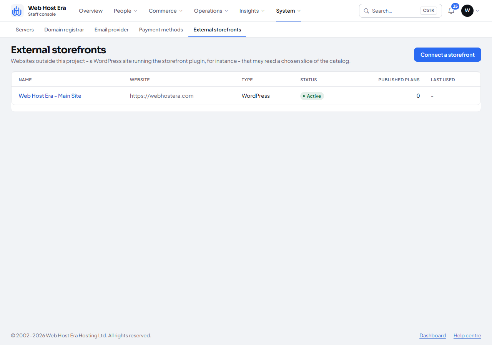
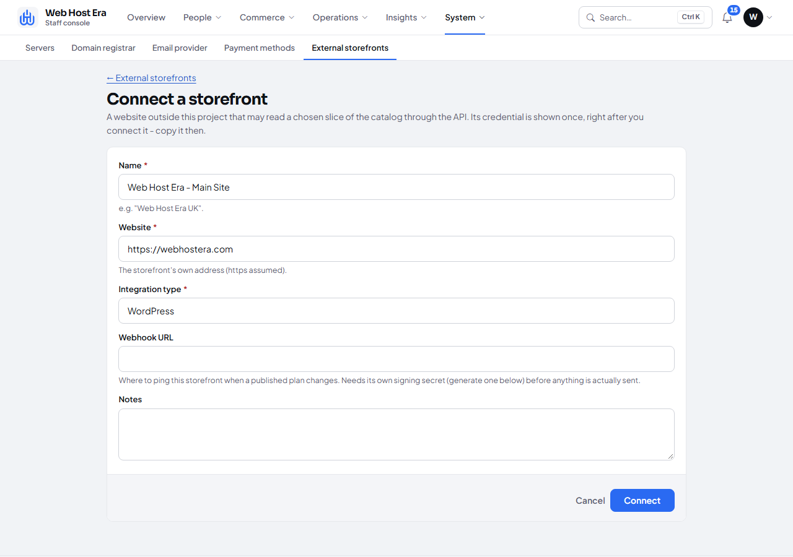
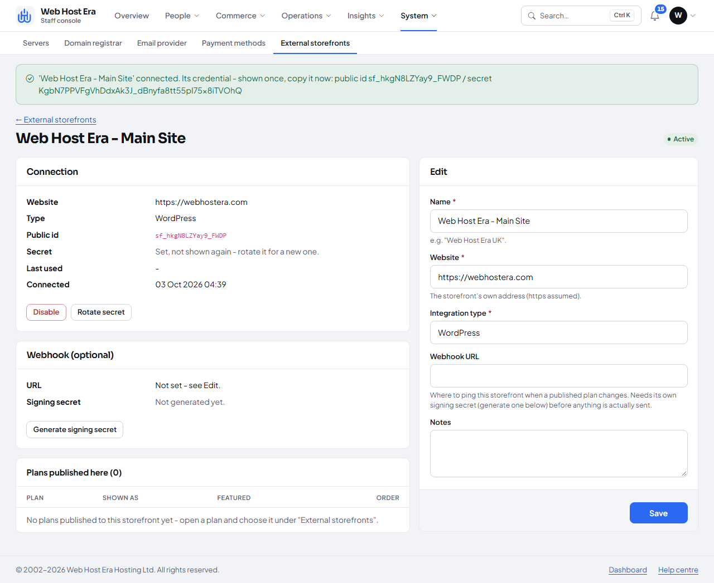
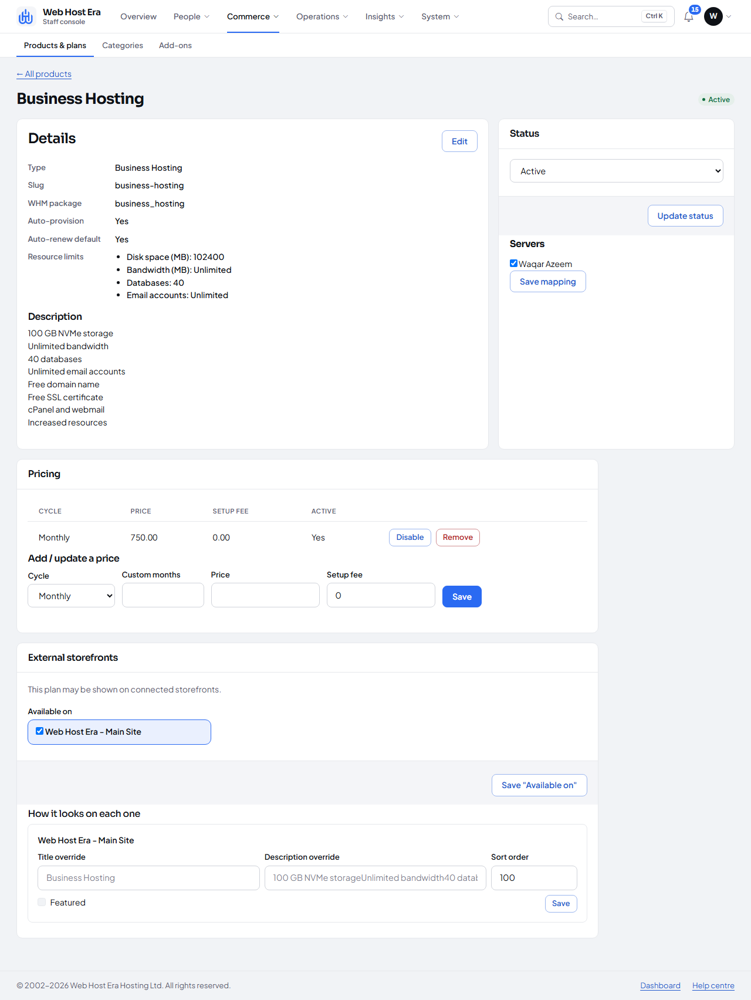
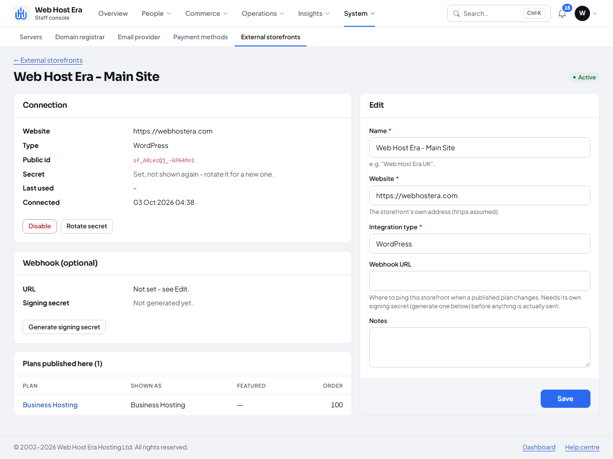

# Connecting an External Storefront (Step by Step, With Screenshots)

**What this is:** a walkthrough of exactly what exists today for connecting an outside website (e.g. a WordPress
site) to this portal's catalog, which value comes from where, and what it's used for.

**What this is not:** a WordPress plugin. None exists yet - building one (the actual PHP code that would run
*inside* WordPress, read these credentials, call the API below, and display the plans) is separate, not-yet-started
work. Everything in this guide is the Django/API side, already built and tested (`docs/e13-storefront-integration.md`).
That is why connecting a *real* WordPress site does nothing today - there is nothing installed on the WordPress
side to receive these values or call this API. This guide exists so that gap is clear, and so whoever builds that
plugin later (or a custom integration of any other kind) knows exactly which value to read from where.

## Step 1: Connect a storefront

**Setup → External storefronts → Connect a storefront.** Before any connection exists, the list is empty:



Fill in a name (for your own reference - it is never sent anywhere) and the site's own address, then **Connect**:



- **Name** - whatever helps you tell storefronts apart later (e.g. "Web Host Era UK", "Web Host Era - Main Site").
  Internal label only.
- **Website** - the storefront's own address. Recorded for reference; nothing is fetched from it.
- **Integration type** - WordPress today (the only kind this project currently models - see `apps.storefronts
  .models.StorefrontType`).
- **Webhook URL** - optional, leave blank unless you already know you want catalog-change pings (see "Webhooks",
  below). Not required for the storefront to work.

## Step 2: Copy the credential - shown exactly once

The moment you connect, the page flashes the **only time the raw secret ever exists outside this one message**:



> `'Web Host Era - Main Site' connected. Its credential - shown once, copy it now: public id sf_ARLezQj_-6P64Mn1 /
> secret <40-odd random characters>`

| Value | Where it comes from | What it is for |
|---|---|---|
| **Public id** (`sf_...`) | Generated automatically when you connect; also shown permanently on the storefront's own detail page afterwards (not secret - safe to note down any time). | Identifies *which* storefront is calling, the same way a username identifies an account. |
| **Secret** (the long random string) | Generated automatically, shown **only in this one flash message**. Walking away without copying it means rotating for a new one (`Rotate secret` on the detail page) - it cannot be revealed again, by design (`docs/e13-storefront-integration.md`, "Security requirements"). | Proves the caller really is that storefront. Both values together go in one HTTP header - see Step 3. |

If you lose it, there is no "show secret again" button anywhere, on purpose. Use **Rotate secret** on the
storefront's own detail page to issue a new one (this invalidates the old one immediately).

## Step 3: What the two values are actually used for

Whatever eventually calls the API (today: nothing; in future: a WordPress plugin, or any other script) sends both
values in a single request header, on every request:

```
Authorization: Storefront sf_ARLezQj_-6P64Mn1:hIGfPQb6Gx_2NGMr_ASpioGlPLFjacz3X4LeZsPLpYQ
```

That is the *entire* authentication mechanism - no login form, no session, no cookie. There is nothing else to
configure. A request with a missing, wrong, or disabled storefront's credential gets `401 Unauthorized` and
nothing else - verified for real in this project's own tests and a live HTTP check against a running server.

## Step 4: Choose which plans this storefront may show

A storefront sees nothing until a plan is explicitly published to it - connecting one does not expose your whole
catalog. Open a plan (**Commerce → Products & plans → (a plan) → External storefronts**), switch on
**Publish externally** if it is not already (the plan's own Edit page), tick the storefront under **Available on**,
and save:



The storefront's own detail page then lists everything published to it:



Two independent switches control whether a plan is visible to a given storefront, and **both** must be on:

1. **Publish externally** (on the plan itself) - a global kill-switch; off hides this plan from *every* connected
   storefront at once.
2. **Available on** (per storefront, on the same screen) - which *specific* storefronts show it.

## Step 5: What calling the API actually returns

Once something is calling with the credential from Step 3, these are the only endpoints it can reach (all
read-only - nothing here can place an order, see a customer, or touch a price):

| Endpoint | Returns |
|---|---|
| `GET /api/v1/storefront/products/` | Every plan published to *this* storefront (id, name, description, category, pricing by billing cycle, features, `order_url`). |
| `GET /api/v1/storefront/products/<slug-or-id>/` | One plan, same shape. |
| `GET /api/v1/storefront/categories/` | Only categories that actually hold a plan published to this storefront. |
| `GET /api/v1/storefront/addons/` | Every active add-on (global, not per-storefront - see the known limitations in `docs/e13-storefront-integration.md`). |
| `GET /api/v1/storefront/domains/pricing/` | Every active TLD's register/renew/transfer price. |

No pagination - a storefront is expected to fetch and cache the whole response, not page through it. The full
request/response shapes, including a worked example, are in `docs/e13-storefront-integration.md` under "API
contract (for the future plugin)".

**The golden rule for anything that ever consumes this API**: it only ever *displays* what these endpoints return
and links "Order now" straight to `order_url` - the customer finishes the purchase on this portal's own checkout.
It never calculates a price, a discount or tax itself, and never stores a card or any payment detail. This portal
is always the one source of truth for what a customer is actually charged.

## Webhooks (optional, not required to use the API above)

If **Webhook URL** is set and a signing secret generated (**Generate signing secret** on the storefront's detail
page - separate from the API secret in Step 2), this project will POST a small, signed "something changed, please
refetch" ping to that URL whenever a published plan's price, name, description or publish status changes. The ping
carries no catalog data - it is only ever a signal to call the read endpoints above again. See
`docs/e13-storefront-integration.md`'s "Webhook ping" section for the exact signature format. This is entirely
optional; everything above works without ever setting it up.

## If/when a WordPress plugin gets built

It would need to, at minimum:

1. A settings screen (inside WP admin) where staff paste the **public id** and **secret** from Step 2.
2. Store them in WordPress options - server-side only, never in a cookie or anything a visitor's browser can read.
3. Call the endpoints in Step 5 with the `Authorization` header from Step 3, from the server side (WordPress's own
   HTTP API, e.g. `wp_remote_get`), on a schedule (and on a webhook ping, if configured).
4. Cache the result and render it as whatever the site's own plans/pricing page looks like.
5. Link every "Order now"/"Buy now" button straight to that plan's own `order_url` - never build a cart or collect
   payment details inside WordPress itself.

None of this exists yet. This guide is what whoever builds it would start from.
